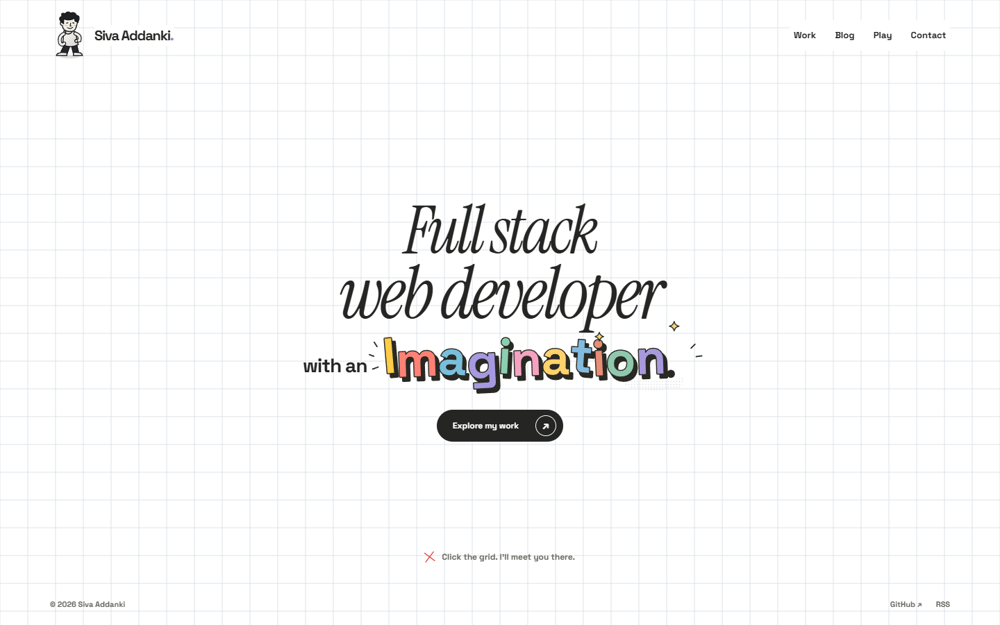
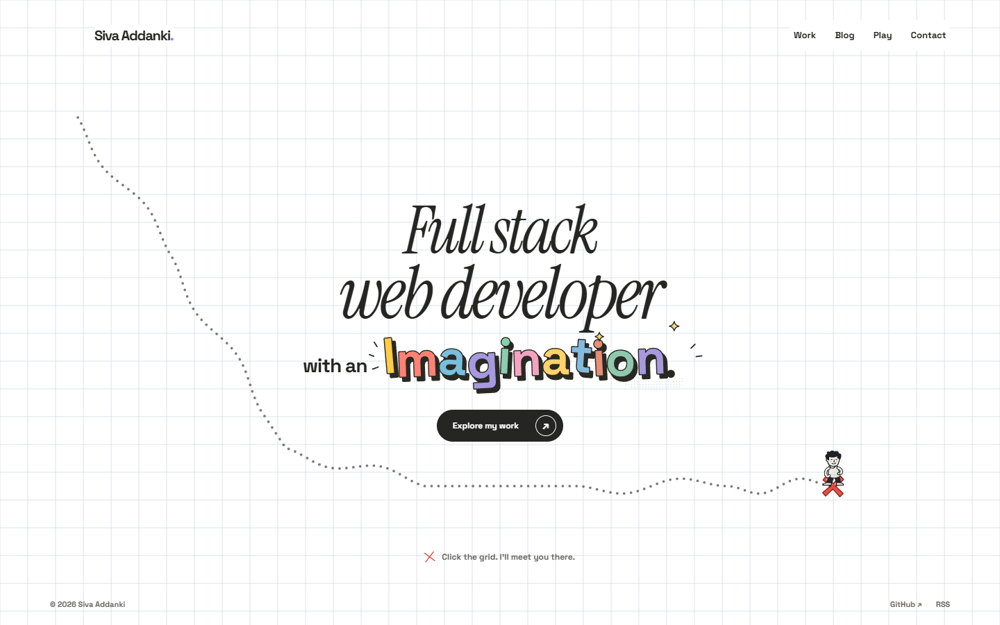
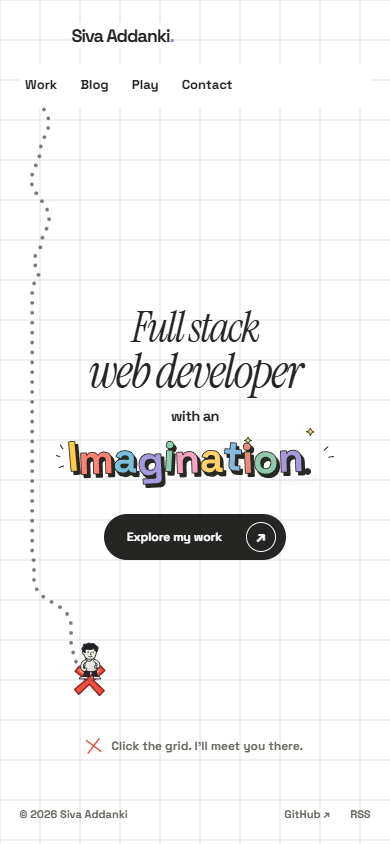

# White grid — current local prototype

This is the replacement direction requested after the paper-cut homepage: a white background, a real Three.js grid, bright comic Imagination lettering, no technology objects, and a custom pointing-finger cursor.

Click an empty spot to place the cartoon red X and show a dotted route. The character walks there and stays. A new click changes the destination from its current position; it does not return home automatically. The cream peel entrance is retained.

**Now deployed, after the owner approved these screenshots:** <https://avsssai.github.io/>. PR [#12](https://github.com/avsssai/avsssai.github.io/pull/12), main commit `5cce6c5d7dd3b795bc218d31e2ecd3376a0869fe`; [successful deployment](https://github.com/avsssai/avsssai.github.io/actions/runs/41323415349).

These are the pre-deployment images captured from <http://127.0.0.1:4332/> in `portfolio-grid`, branch `poteto/portfolio-grid`. This gallery-only branch still contains historical application source; it is not the source of the screenshots. Publication of this gallery did not itself deploy the application.

## Desktop

## Desktop after walking to a clicked destination

## Phone-sized viewport after arrival

The phone view is desktop Chrome at 390×844 with touch emulation, not a physical phone. The desktop view is 1440×900. Native system cursors are not captured in these browser screenshots; the actual local SVG used for the fine-pointer cursor is shown separately below (hotspot 11,3).

