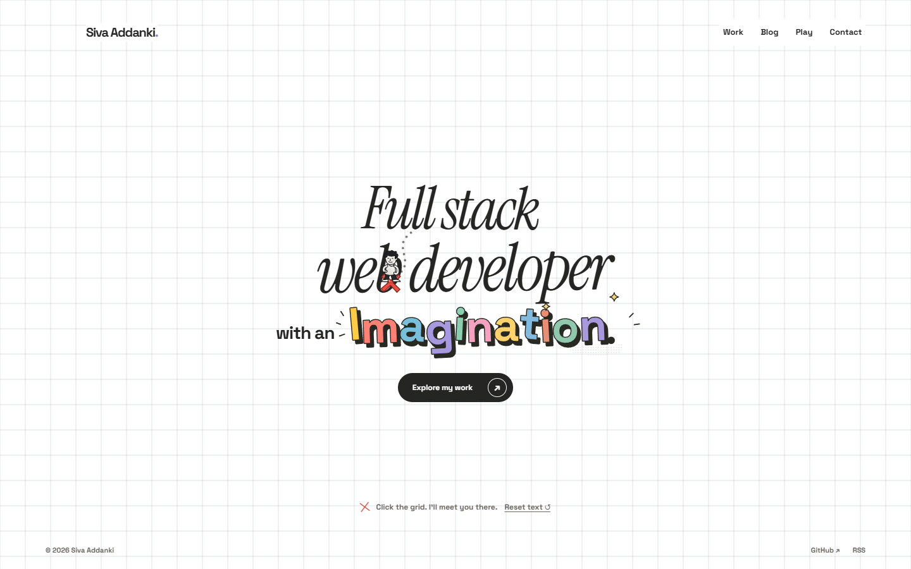
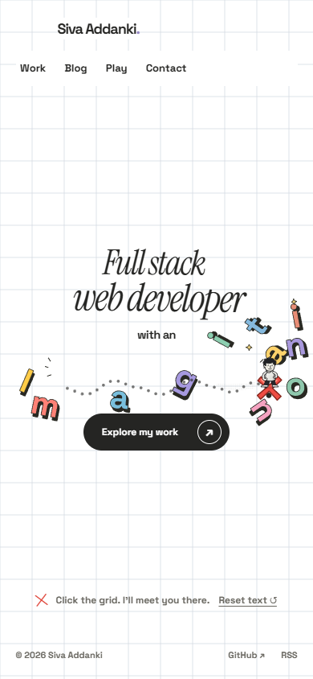
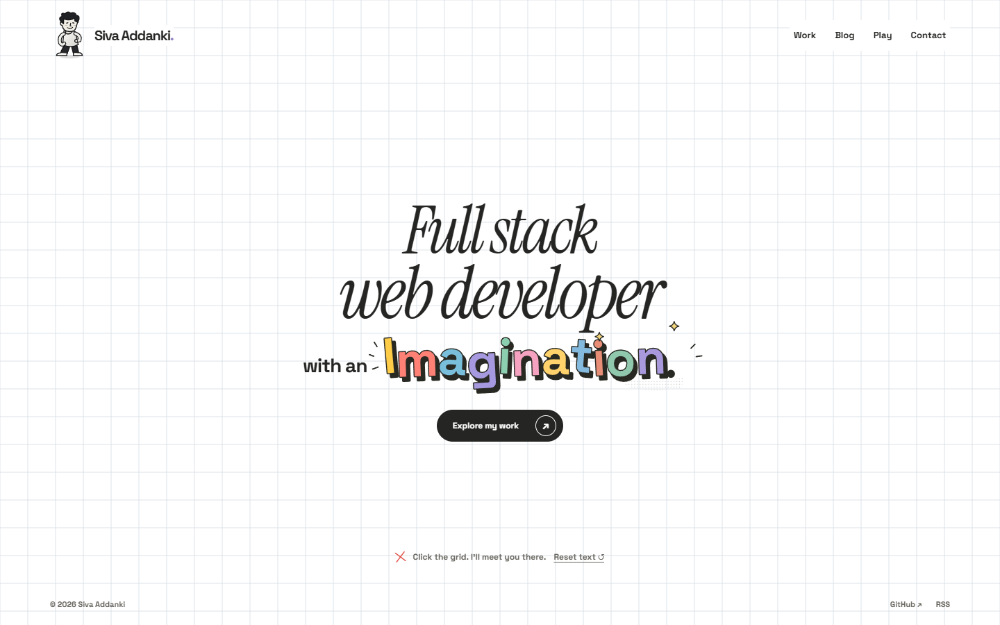

# Heavy headline, loose Imagination — updated preview

**Preview only; the live site is unchanged.** The headline now has two physical personalities: solid, restrained **Full stack / web developer** blocks above the loose comic letters.

## Watch

- **[Phone video — about 9 seconds](phone.mp4)**
- **[Desktop video — about 11 seconds](desktop.mp4)**

The character walks into **Full stack**, then **web developer**. Each complete line gives a small nudge and tilt, rather than breaking into letters or flying away. He then walks through **Imagination**, which still slides, rotates and collides letter by letter. **Reset text** restores the entire composition at the end; he stays at his red X.

The headline reactions are intentionally much quieter than the loose lettering. Nothing moves on hover or by itself, and even stopping inside a headline does not leave an idle simulation running. The white Three.js grid, original fonts/colourful artwork and fine-pointer finger cursor are retained. Native cursors are not captured in the recordings.

## Headline contact

## Contrast after walking through Imagination

## Starting composition

## Scope and evidence

Two high-density, locally constrained headline bodies share the existing Matter.js world with the twelve SVG glyph bodies. The headline moves at most 12px horizontally, 3px vertically and about 0.7°; smaller typography has smaller displacement limits. These are bounded editorial physics, not unrestricted or exact concave-outline simulation.

- Accessible complete native heading and native links remain. No-JS, reduced-motion and physics failure keep the static composition. Instant keyboard placement does not create collision impulses.
- **64 pure tests**, production build/typecheck and **22 browser cases** pass locally. Coverage includes both headline blocks on Chrome/Firefox desktop and touch-emulated phone viewports, impacts during walking, bounded movement, sleeping while standing inside a headline, loose-letter collisions, reset, preference/failure paths and the existing grid regressions.
- A fresh read-only source/screenshot review found no established blocker; the reader did not independently run the browser suite.
- Recordings are desktop Chrome, not physical phone hardware. Desktop source is 1440×900, encoded to 960×600; phone retains 390×844. Both H.264 files were decoded and six frames per clip inspected. Physical-phone, Safari/WebKit, assistive-technology and native background-tab/BFCache validation remain open.

Implementation: [`58d29be912f85b5a0deb459b6ed8af90e9ac5139`](https://github.com/avsssai/avsssai.github.io/commit/58d29be912f85b5a0deb459b6ed8af90e9ac5139), branch [`poteto/portfolio-letter-physics`](https://github.com/avsssai/avsssai.github.io/tree/poteto/portfolio-letter-physics). Interactive development preview: `http://127.0.0.1:4333/` on the development machine.

This branch is a media gallery, not the implementation. Public main remains the approved white-grid deployment at `5cce6c5d7dd3b795bc218d31e2ecd3376a0869fe`. **Await feel/visual approval before deploying.** [Previous loose-letter-only preview](../letter-physics/README.md).
