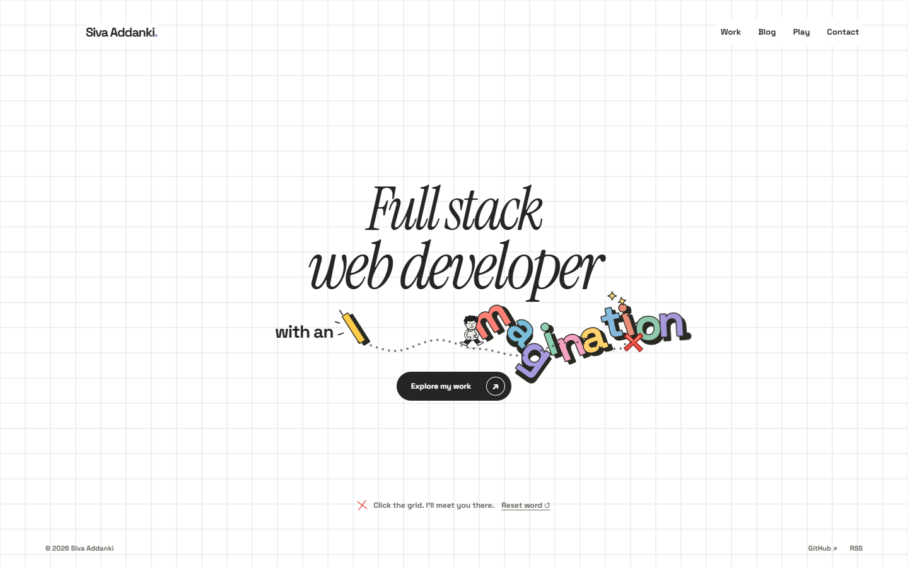
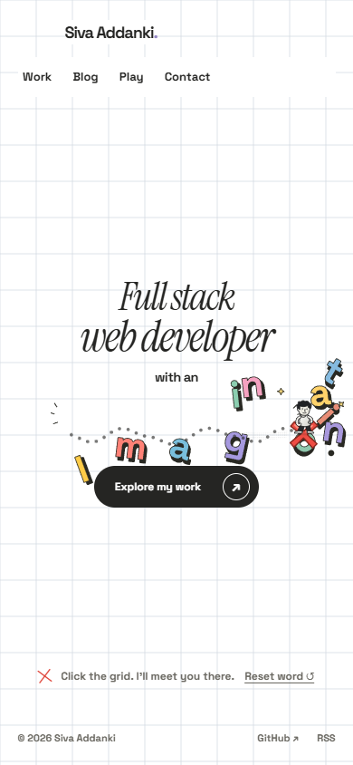
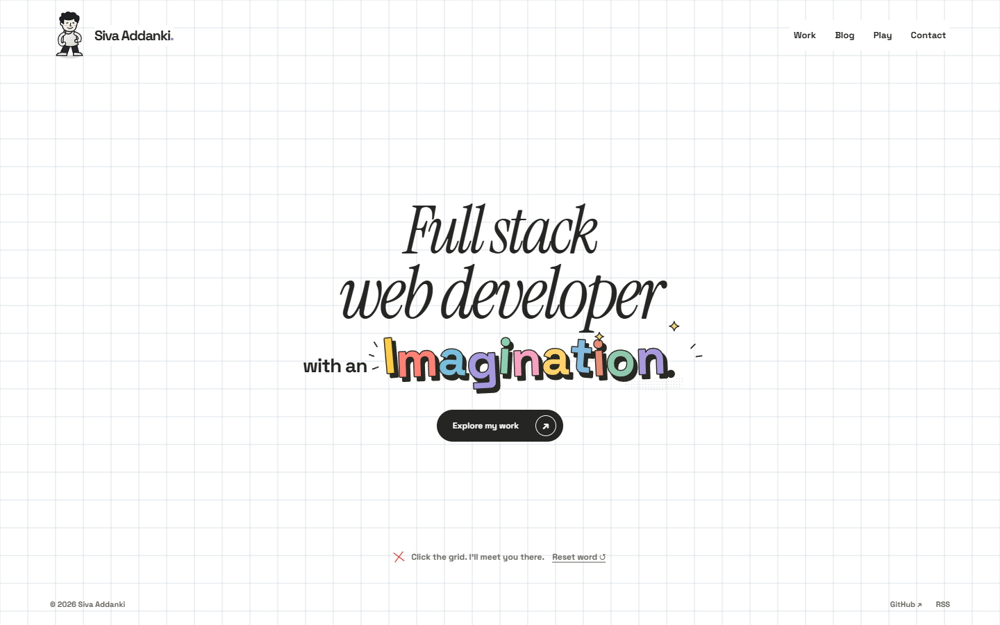

# Walking through Imagination — physics preview

**Historical loose-letter-only preview.** The subsequent [heavy-headline + loose-letter version](../headline-physics/README.md) was approved and is now [live](https://avsssai.github.io/). These earlier clips keep the approved white Three.js grid, original colourful comic letters, pointing-finger cursor and red-X destinations.

## Watch the interaction

- **[Phone video — about 6 seconds](phone.mp4)**
- **[Desktop video — about 8 seconds](desktop.mp4)**

He walks into the first letter, then across the word. Individual letters slide and rotate, contact pushes their neighbours, and the response is capped to his scale rather than launching the whole title. They settle where they land. The clips finish by activating **Reset word**, which immediately restores the composition; he stays at his destination.

These are recordings of the working local build, not keyframed mockups. The finger cursor remains on fine-pointer devices, but native cursors are not captured in these videos.

## During contact

### Desktop

### Phone viewport

### Original composition / reset state

## Scope and verification

- Real **2D Matter.js rigid-body contact** driving the original SVG glyphs, not extruded replacement lettering. Eleven letters plus the period have independent bodies; letter-to-letter collisions transfer motion.
- No idle letter movement. Physics stops scheduling frames when the bodies sleep. Other heading copy, links and controls retain protected regions.
- Accessible complete heading remains intact. No-JS, reduced-motion and physics-failure modes keep the static word; keyboard placement is instant and does not impart a teleport impulse.
- Production build/typecheck, **60 pure tests** and **18 browser cases** pass locally: five focused Chrome physics cases plus thirteen existing Chrome/Firefox grid cases. Tests cover settling, reset, saved-theme changes, keyboard placement, reduced-motion changes, import failure and synthetic lifecycle teardown/remount.
- These are desktop Chrome recordings at 1440×900 and a touch-emulated 390×844 viewport. Desktop video is encoded at 960×600; phone video retains 390×844. Physical-phone, Safari/WebKit, assistive-technology and native BFCache/background-tab validation remain open. Colliders approximate ink bounds rather than exact concave glyph outlines.

Implementation: [`633c6fe97072d7b1852b6ae81e3c84f1fc655e4c`](https://github.com/avsssai/avsssai.github.io/commit/633c6fe97072d7b1852b6ae81e3c84f1fc655e4c), branch [`poteto/portfolio-letter-physics`](https://github.com/avsssai/avsssai.github.io/tree/poteto/portfolio-letter-physics). Local interactive preview: `http://127.0.0.1:4333/` on the development machine.

This branch is **media-only**; its historical application code is not the implementation. The final combined version deployed via [PR #13](https://github.com/avsssai/avsssai.github.io/pull/13) at main `904aec78bc07945e3361cf9c9110749a74def5a8`. The metrics above describe this earlier loose-letter-only checkpoint.
