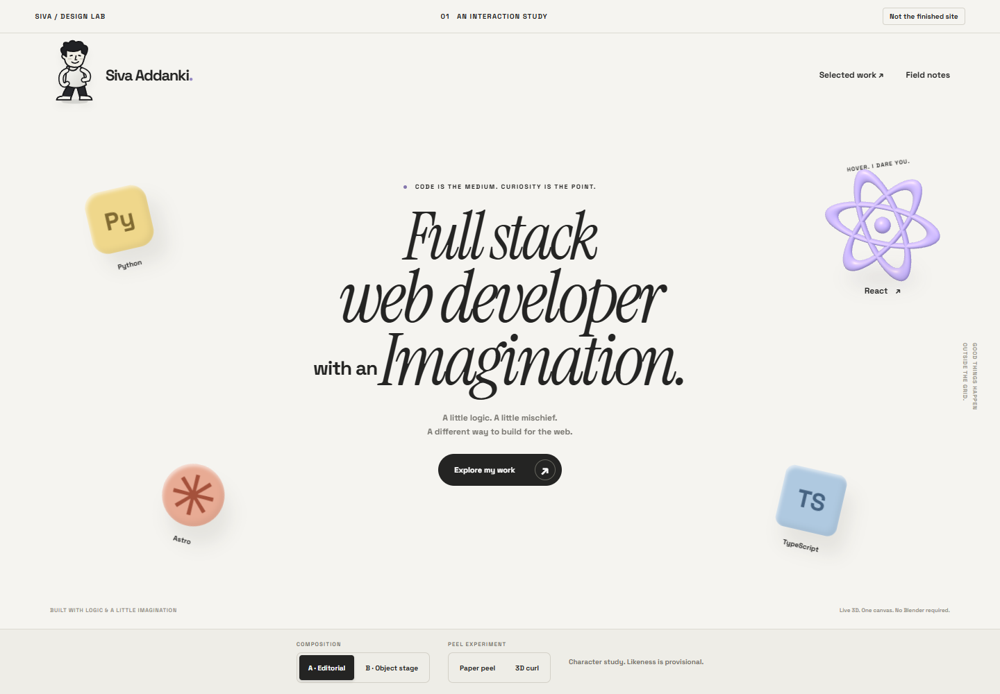
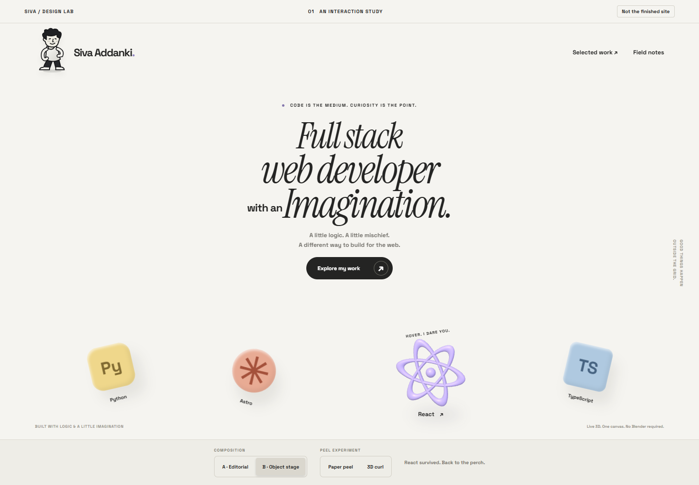
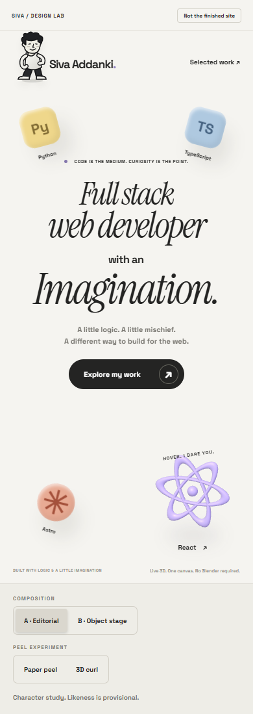
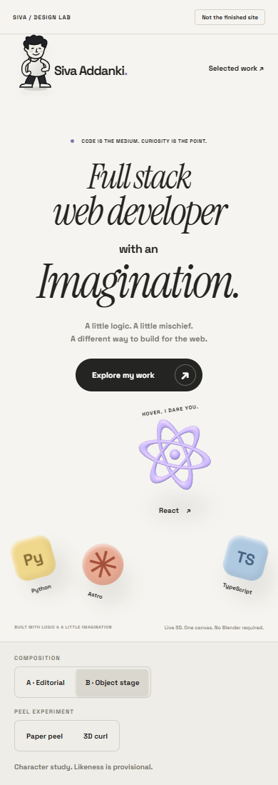
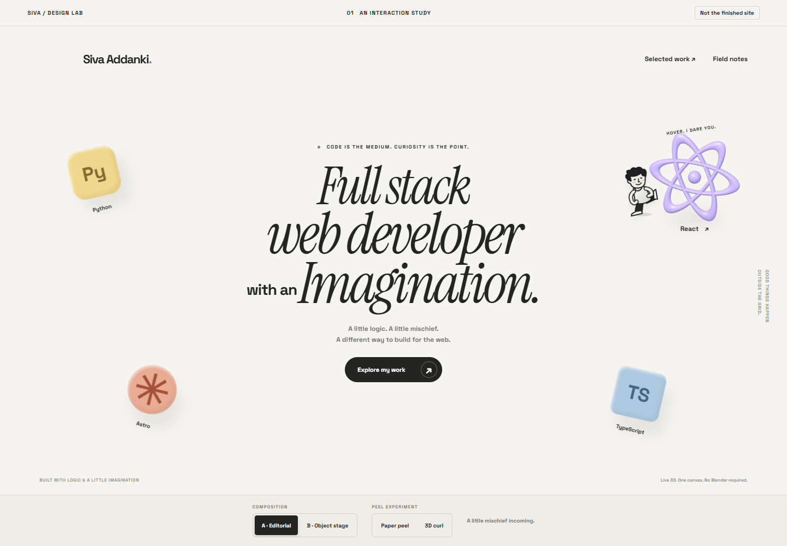
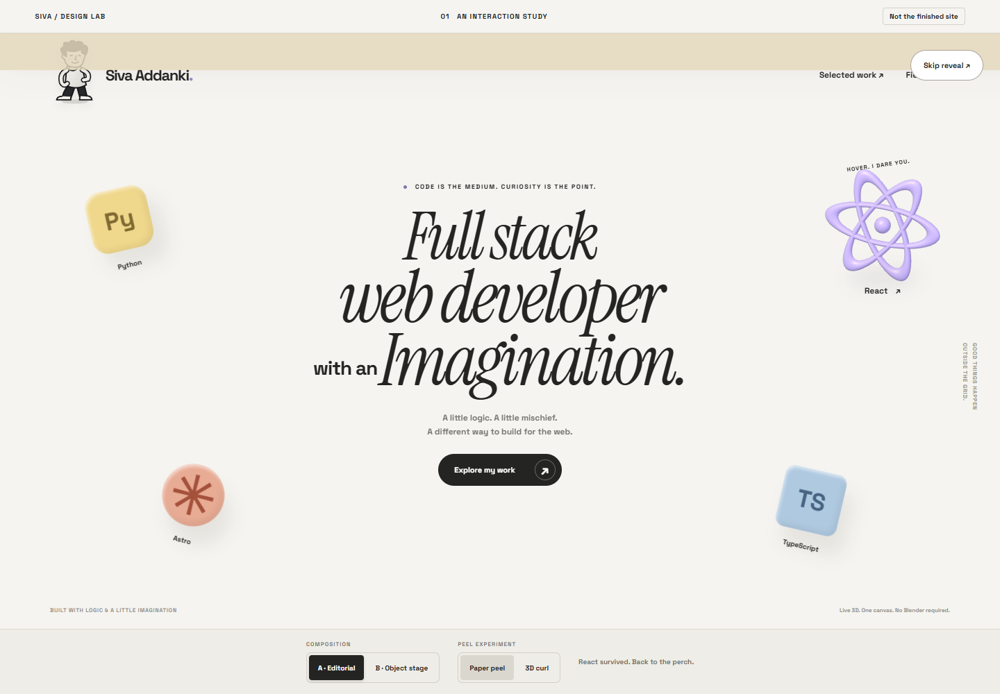
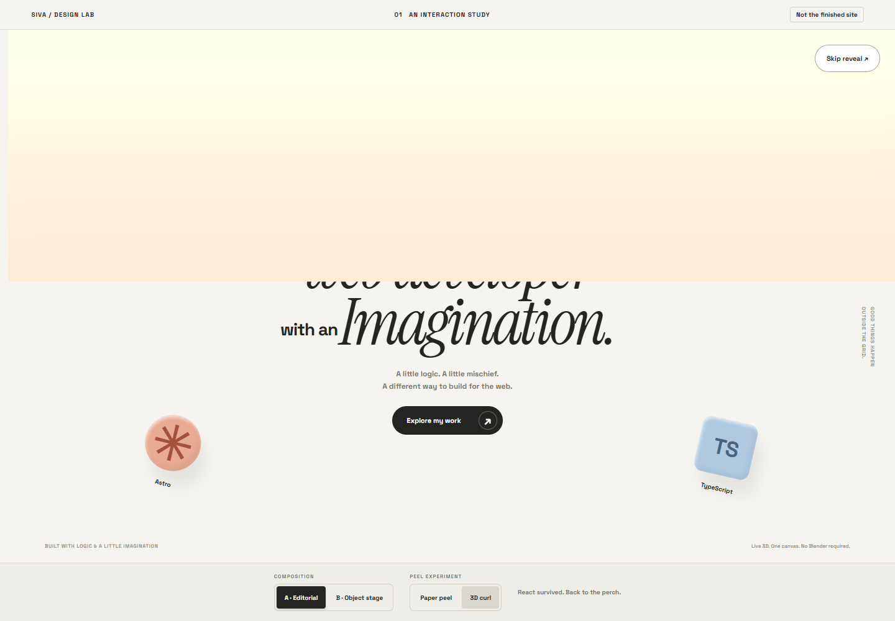

# Review the first portfolio prototype

Open the throwaway lab at `/lab/portfolio/` on the P01 branch. The production homepage is unchanged.

## Choose a composition

Candidate A uses larger central typography and objects around the edges. It gives the character more room to travel without turning the stack into a toolbar. The operator approved this direction.

Candidate B places objects in a lower stage. It separates the headline from the interaction, but the smaller desktop headline has less emphasis.

Compare the mobile arrangements before approving either direction.

## Inspect the character

The SVG drawing is original and editable. The likeness is provisional. The React object is live Three.js geometry. Python, TypeScript, and Astro are static composition placeholders in this ticket.

The contact screenshot pauses the kick animation at 110 ms so its limb position can be inspected. The browser driver resumes the animation and waits for it to finish.

[Watch the 37-second interaction recording](review.webm). The compressed recording is about 697 KB. It includes both layouts, the kick, and both peel experiments. It also deliberately pauses an animation to check the safety dismissal. It is a prototype recording, not a production loader demonstration.

## Compare the peel experiments

The CSS paper peel has typography and a folded corner. The operator approved this direction. The operator then requested a slower peel. Its duration is now 1400 ms instead of 800 ms, with a 2500 ms safety dismissal and immediate skip.

The deformed mesh tests geometry and lighting. Its untextured sheet does not match the paper treatment. Neither experiment yet achieves the final bandage-like curl. Do not call this a finished loader.

Both experiments are manually triggered. Both offer skip and a safety dismissal. The production readiness-driven entrance belongs to P05.

The original paper reveal completed in 895 ms in a live browser probe. After the timing refinement, the browser scenario observed completion in 1450 ms. The authored duration is 1400 ms. The scenario also checks immediate skip and a 2500 ms safety dismissal when the animation is deliberately paused. The metrics below predate this timing-only refinement and remain historical evidence for their named revision.

## Read the measured evidence

The following run used code revision `daac2b88338f2a011512244c3826916d7c2576ee` and trunk `7cf8da1f5eaa3fc5696545c28d190852a3a844b6`.

The browser was local desktop Chrome through Playwright. The viewport was 1440 by 1000. Performance runs used cold cache, 4x CPU throttling, and local preview servers without network throttling. These are not real-device results.

| Measurement                                      | Observed      | Gate                        |
| ------------------------------------------------ | ------------- | --------------------------- |
| Trunk homepage heading readiness, median of five | 834 ms        | Record baseline first.      |
| Head homepage heading readiness, median of five  | 764 ms        | No regression above 200 ms. |
| Lab document and resource transfer               | 194,516 bytes | At most 1 MB.               |
| Deferred scene transfer                          | 131,532 bytes | Included in the lab budget. |
| Active p95 animation frame interval              | 17 ms         | At most 33.4 ms.            |
| Kick completion                                  | 1,088 ms      | At most 2 seconds.          |
| Lab CLS                                          | 0.0194        | Reported for the prototype. |
| Additional scene frames over one idle second     | 0             | No idle render loop.        |

Do not interpret the small homepage timing difference as a speed improvement. The homepage is unchanged and run-to-run noise remains.

All ten browser scenarios passed on the code revision. The scenarios cover trunk navigation, both compositions, anchor projection, the full phase sequence, keyboard, touch emulation, reduced motion, disabled JavaScript, blocked scene import, context loss, resize cancellation, browser-history restoration, busy-request suppression, and twenty completed kicks.

The history check enables the browser's real back-forward cache. Before the fix, returning restored the page with zero canvases and dead controls. The fix preserves the mounted scene and listeners for cached documents. Two consecutive cached returns now complete a kick.

The reduced-motion path does not download the Three.js chunk. The build still warns about a large uncompressed deferred Three.js chunk. The measured transferred size is shown above. Keep watching that budget as production assets are added.

## Read the review limitations

This is self-verified prototype evidence, not an independent clean stack verdict. The subagent tool was unavailable. The expected model configuration was missing. Both CLI launch probes timed out. No peer agents were available. No independent model panel ran.

The inline review used `openai/gpt-6.1-sol`. It found and fixed the cached-history lifecycle bug and removed an unnecessary Three.js download under reduced motion. No application comments or lint suppressions were added. OFL notices remain intact.

The first CI run failed on formatting in the lockfile and new Astro markup. Both were corrected. Windows line-ending differences were normalized only in the isolated worktree. The aggregate diff contains no edits to existing production pages or shared styles.

The user approved Candidate A and the paper reveal direction. The character likeness remains provisional. The revised paper timing still needs a feel-check. Real touch hardware, non-Chromium testing, final likeness, seven-object rendering, letter effects, and a readiness-driven loader are not complete in P01.

## Continue only after review

Record Candidate A and paper peel as the operator's decisions on issue 1. Keep this PR unmerged. Do not deploy. Check the slower paper timing before P02 resumes.
