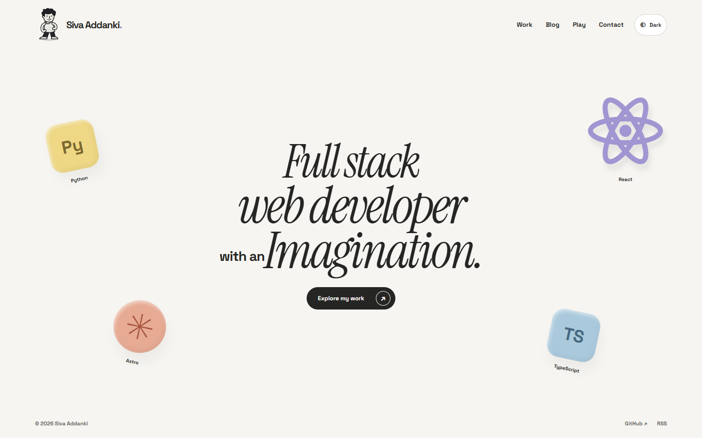
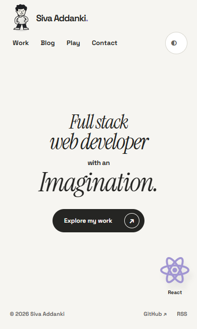
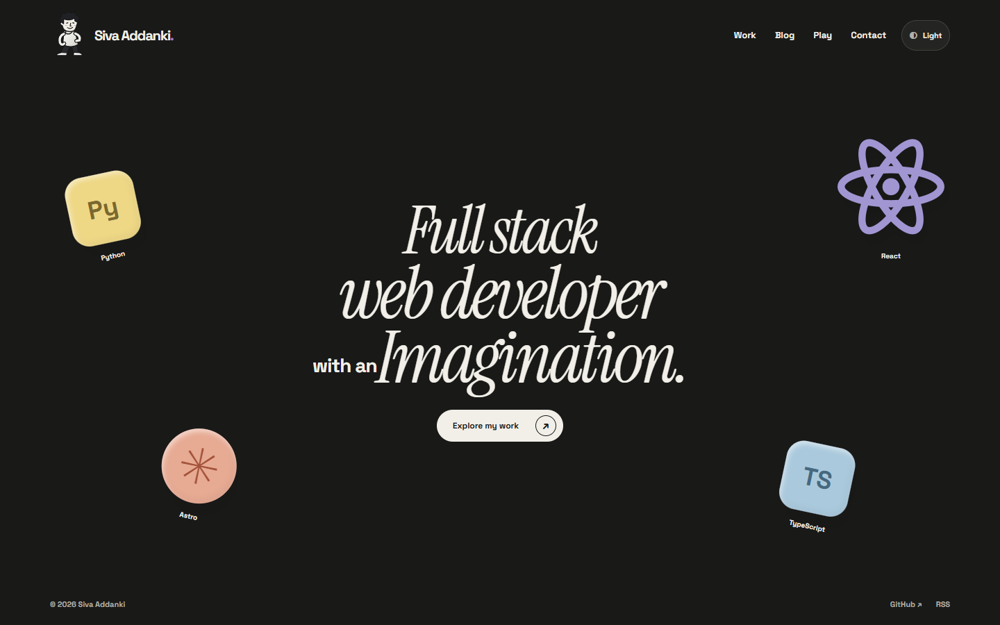

# P02 visual preview

These are screenshots of the production homepage replacement on the P02 branch. P02 is not merged or deployed. This is the static foundation, not the finished seven-object WebGL scene or character interaction.

The approved headline remains. Supporting slogans and invented project or contact details are removed. Artwork is provisional. The game is outside the current redesign and dedicated verification scope.

## Desktop

## Mobile

## Dark mode

## Verification status

The local production build, Astro checks, formatting, responsive checks, keyboard navigation, no-JavaScript navigation, font failure, theme persistence, and native Chrome 200-percent zoom checks pass. Five interleaved cold baseline/head performance runs pass the planned home, work, and article budgets. A misleading full-page zoom screenshot is excluded from this preview. Screenshot framing at that zoom needs a separate correction; the live zoom geometry and work-link activation passed.

Fresh independent verification and the operator's visual review remain open. The existing starter article is preserved, not presented as new portfolio content. No P02 merge is authorized by this preview.
