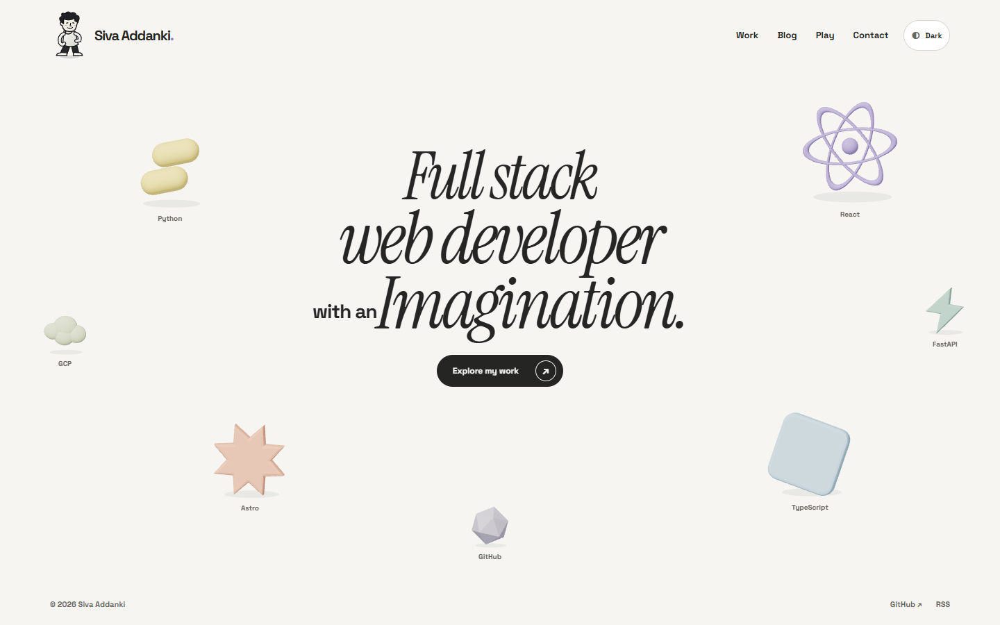
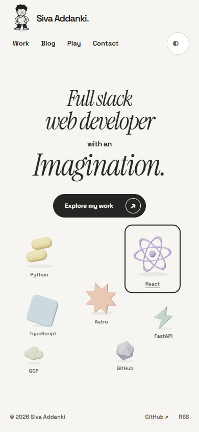
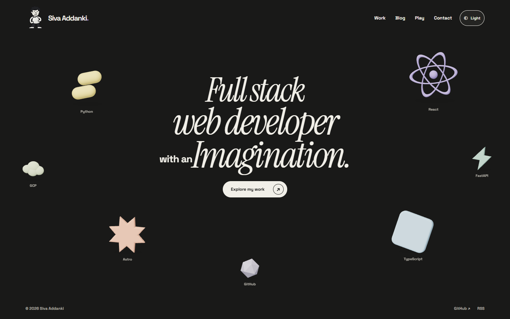
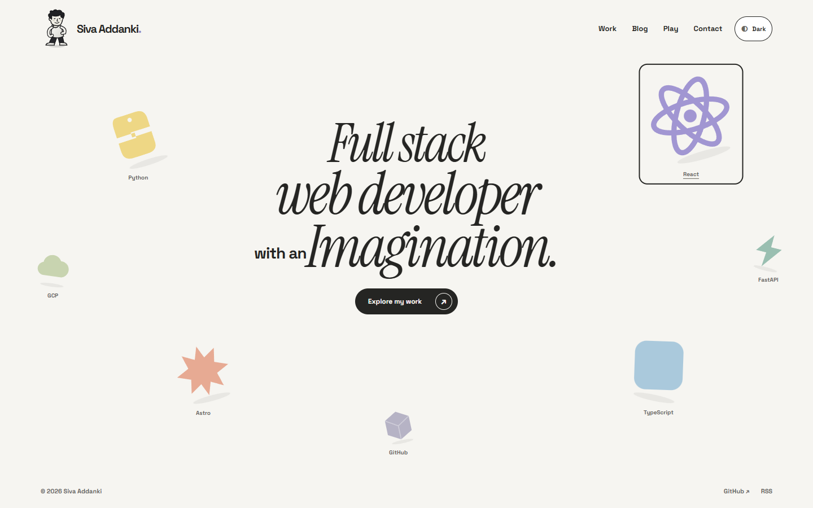
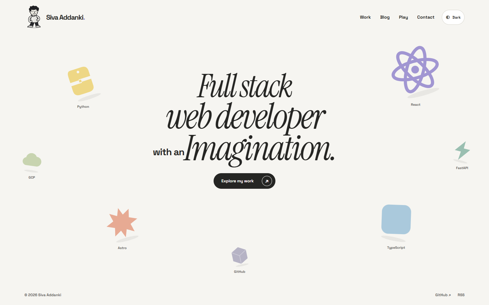

# P03 scene preview

[PR #9](https://github.com/avsssai/avsssai.github.io/pull/9) adds the shared stack scene on top of [P02 PR #8](https://github.com/avsssai/avsssai.github.io/pull/8). Neither PR is merged.

These captures use placement revision `85e40e70ba76ba288f3a7a98d92190924f5c140c`. The operator rejected the earlier two-column layout. This version uses uneven positions, different sizes and individual tilts, with an asymmetric mobile arrangement instead of the icon grid. Seven original abstract technology objects still share one canvas. Labels and selection controls stay in HTML. The character kick and paper reveal are later work.

## Desktop

## Mobile

## Dark theme

## WebGL failure

This image follows real WebGL context loss. SVG artwork replaces the canvas without removing labels or navigation.

## Reduced motion

Reduced motion uses static artwork and does not download the React/Three scene.

## Walkthrough

[Download or open the 35-second walkthrough](https://raw.githubusercontent.com/avsssai/avsssai.github.io/poteto/portfolio-p03/docs/portfolio-review/p03/review.webm).

The video shows desktop light and dark, HTML keyboard selection, the mobile layout, context-loss fallback and reduced motion. Encoded duration is 33.64 seconds; the recorder measured 34.764 seconds wall-clock. The coordinator inspected the desktop and mobile screenshots, not a continuous video watch. Recording metadata is in [recording.json](recording.json).

## Checks and limits

For this placement revision, build/type checks, four pure tests and the existing desktop, touch-mobile and repeated-resize/projection scenarios passed. The resize scenario includes seven viewport sizes. No broader test expansion or full performance rerun was needed for the placement change.

The earlier implementation passed the 19-scenario landing driver and received an independent PASS+NOTES review at `8e8170b`. That review predates the placement revision. Visual approval of the new composition remains open.

The earlier composition's five interleaved P02/head cold loads at 4x CPU measured a -20.3 ms median heading delta, at most 312,231 deferred transferred bytes and a 1.866-second maximum first usable scene frame. Maximum observed CLS was .02465. These are local automation proxies, not field Web Vitals.

The scene renders on demand. A ten-second resize workload measured 17 ms browser p95 frame intervals. This is not continuous WebGL animation FPS. A genuine hidden Chrome tab recorded zero draw calls for five seconds after settling and resumed rendering afterward.

The first idle measurement included pending final-resize frames and failed. A targeted rerun after 500 ms settling recorded zero idle draws. The original failed receipt remains in the local evidence directory.

Operator visual approval, actual-device testing and non-Chromium release checks remain open. No game tests ran. These screenshots are evidence for review, not permission to merge or deploy.
