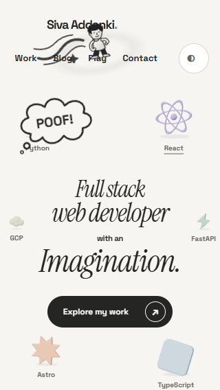
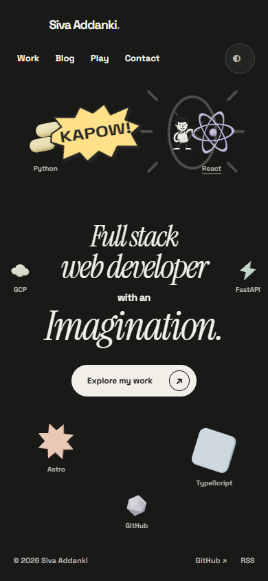

# P04 cartoon character review

Each accepted hover, tap or keyboard activation randomly selects a kick or punch. Nothing attacks while idle. Busy requests are dropped; geometry or scene changes cancel the sequence. Reduced motion keeps selection without choreography.

The cartoon revision adds `POOF!` at takeoff, `KACHOW!` for kicks, `KAPOW!` for punches, longer curved jump/return trails, a stronger local pressure ring and directional object squash. The paper dent is shading behind content, not actual text distortion. No audio, screen shake or flashing page. Impact lasts 240 ms; the nominal sequence is 1,080 ms. Artwork likeness and cartoon timing still need operator approval.

## Preview

[Play or download the current 34-second cartoon walkthrough](https://raw.githubusercontent.com/avsssai/avsssai.github.io/poteto/portfolio-p04/docs/portfolio-review/p04/review.webm)

Recorded from application `ff141ef30dfa309aa08520c6178b028962fe8897`, after the viewport-clipping fix. It shows naturally random desktop actions, a narrow viewport, reduced motion and context-loss fallback. The narrow segment is resized desktop, not touch hardware.

The compressed preview is 960×600, 1,045,289 bytes and 33.571 seconds. The full original remains outside the repository in `portfolio-evidence/P04/comic-clip-recording/review.webm`. Browser metadata and decoded frames were inspected, including desktop KACHOW and narrow KAPOW; this was not a continuous watch.

### Takeoff cloud and curved trail at 320 px

### Travel strokes and paper dent

### Cartoon impact

### Centered desktop hero at 1920 px

### Phone punch, light and dark

### Unchanged static states

Perch, fallback and reduced-motion images are retained from the preceding P04 review; they are not new cartoon captures.

## Focused verification and limits

Verified application: `ff141ef30dfa309aa08520c6178b028962fe8897`, based on P03 `054c9edd7b7d600e37d80226a545576248b85565`. Subsequent gallery changes do not change application or test drivers.

- 20 pure tests and build/type check passed: 0 errors, 0 warnings, 3 existing script typing hints. Existing deferred-chunk size notice remains.
- Five affected browser cases passed with no page errors: effects, comic-responsive, cancellation, reduced motion and twenty-action repetition. Responsive coverage includes both moves at 320/390 px light, 390 px dark and 1920 px light. It checks readable cloud/burst windows, no annotation overlap with heading glyphs/navigation/actor, stable heading bounds, cleanup and no horizontal overflow at takeoff/impact/edge-target return.
- The earlier return-trail probe genuinely failed at FastAPI (320→360 px and 390→422 px scroll width). Horizontal viewport frames now clip the long swoosh/paper dent while retaining vertical overflow for the header perch. The focused rerun passed, including the centered wide-hero origin. The failed receipt is preserved.
- Active-only performance at this application SHA: 20 alternating actions, Chrome 156, 1440×900, 4× CPU, local network. Max acknowledgment 15.5 ms, active rAF p95 17 ms, settled DOM growth 0, retained WAAPI animations 0. All four active gates passed. These are local automation proxies, not field FPS/paint metrics.
- No new cold benchmark, broad-suite rerun or independent cartoon review. Earlier independent PASS+NOTES reports at `117ac4c` and `443786e` predate the cartoon revision and are historical, not current-head verdicts. The earlier +11.7 ms cold-heading delta is historical at `443786e`.
- Native hidden-tab/persisted-pagehide interaction cancellation remains source-reviewed rather than newly browser-probed. Actual touch hardware, non-Chromium, likeness and final cartoon visual approval remain open.
- No game work, merge or deployment. P05 has not started.

Receipts: local `portfolio-evidence/P04/comic-clip-{final,perf,recording}`, `comic-clip-unit.log`, `comic-clip-build.log` and preserved `comic-return-overflow-before-fix.json`. This gallery is for operator review, not release approval.
