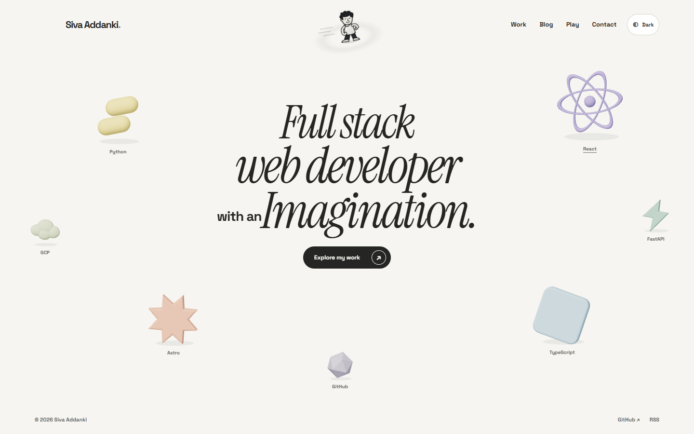
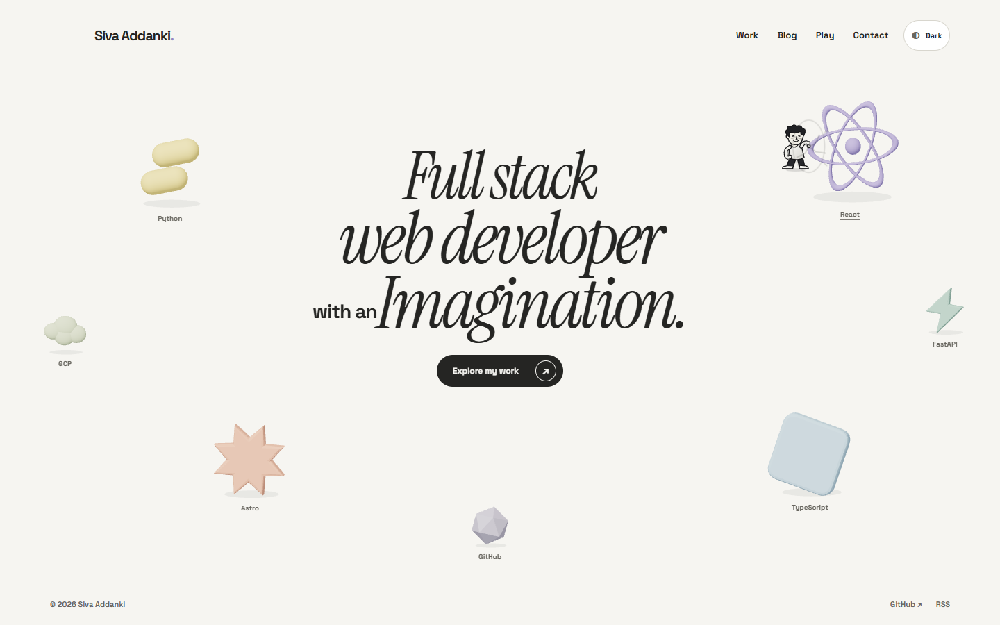
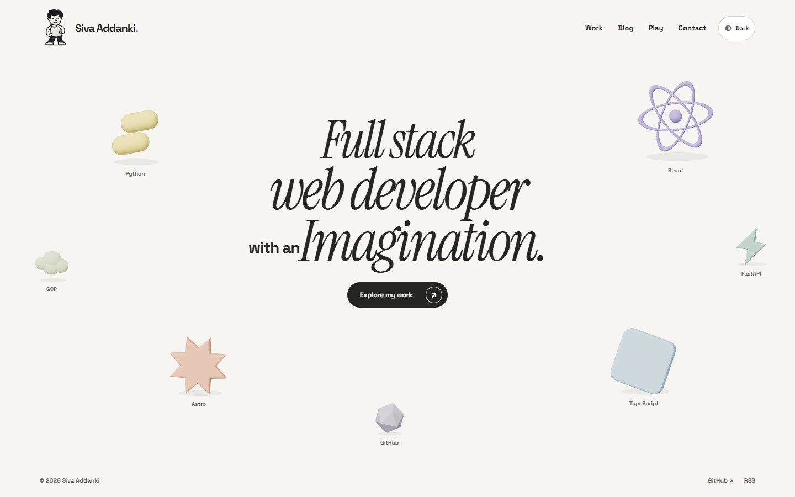
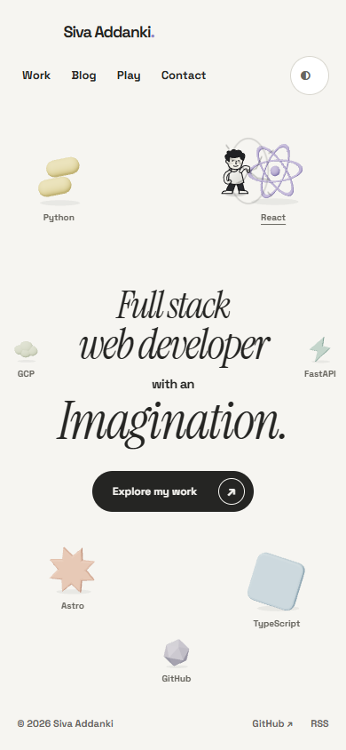
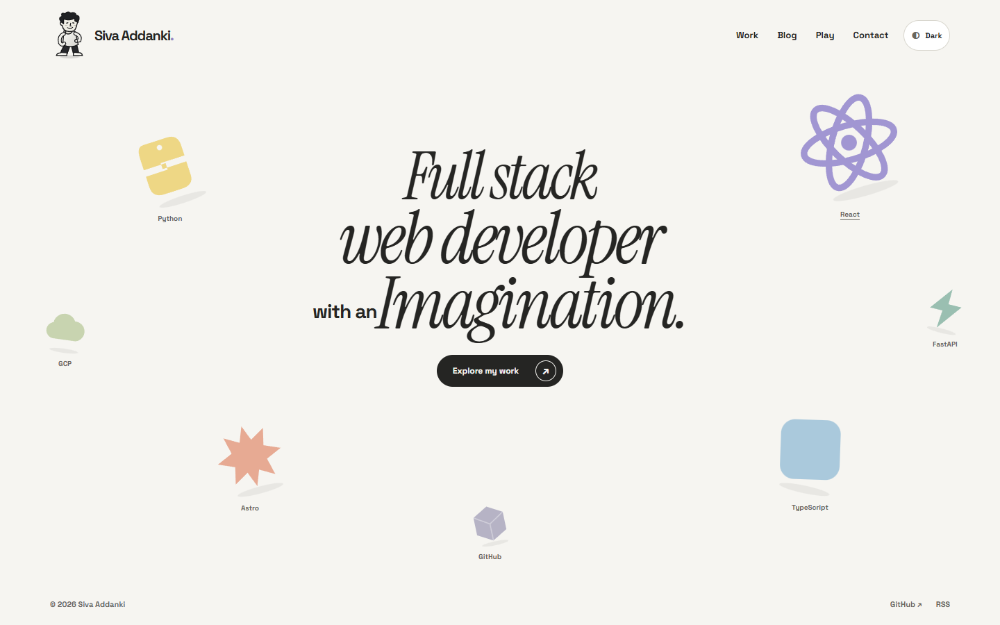

# P04 character review

Each accepted hover, tap or keyboard activation randomly selects a kick or punch. Nothing attacks while the page is idle. The character returns to the header perch, drops busy requests and cancels when the page geometry or scene changes. Reduced motion keeps selection without travel or impact.

The latest revision adds speed strokes, a subtle paper-dent illusion along outbound travel, a pressure ring at contact and directional object squash. The paper effect is shading behind the content, not actual text distortion. The heading and controls do not move.

Artwork likeness and the latest effects need Siva's review. The character remains an original provisional SVG, not an approved portrait.

## Preview

[Play or download the 34-second walkthrough](https://raw.githubusercontent.com/avsssai/avsssai.github.io/poteto/portfolio-p04/docs/portfolio-review/p04/review.webm)

This updated recording includes the motion accents. It shows naturally random desktop actions, a narrow viewport, reduced motion and context-loss fallback. The narrow segment uses a resized desktop browser, not a touch device. Phone taps were checked separately in the browser suite.

The compressed preview is 960×600, 881,430 bytes and 33.548 seconds. The 1440×900 original is 33.56 seconds and remains outside the repository in `portfolio-evidence/P04/effects-recording/review.webm`. Browser media metadata and decoded frames were inspected, not a continuous watch.

### Travel strokes and paper dent

### Pressure ring at contact

### Header perch

### Desktop kick contact

### Phone punch contact

### Scene failure

### Reduced motion

## Checks and limits

Current application is `117ac4c946be3cb34d43f8cf36214b5635ea9983`, based on P03 `054c9edd7b7d600e37d80226a545576248b85565`. Later gallery/recorder changes do not alter application source. The unchanged perch/fallback/reduced images remain from the preceding P04 review; motion images and video are updated.

- 13 pure tests, build/type checks and the compact 12-case browser suite passed. No page errors. The added case checks visible travel/impact effects, unchanged heading bounds and effect cleanup. Existing cases cover contact, busy requests, phone tap, keyboard focus, reduced motion, cancellation, route return, context loss, target removal and twenty alternating actions.
- A fresh read-only effects review returned PASS+NOTES at the current application SHA. It ran the 13 tests, type checks and five affected browser cases: effects, touch, cancellation, reduced motion and repetition. It found no blockers. Type checks have no errors or warnings; three nonblocking script typing hints remain.
- The current active-only performance probe ran twenty alternating actions at 4× CPU. Maximum acknowledgment was 9.7 ms, active rAF p95 was 16.9 ms, settled DOM growth was zero and no WAAPI animations remained. All four active gates passed. Cold-heading measurements were not rerun for this visual revision.
- Earlier five-interleaved-cold-load measurements at `443786e` compared with the verified P03 parent: heading median delta +11.7 ms. Those remain historical evidence, not a benchmark of the new effects. All performance results are local automation proxies, not field paint metrics.
- The earlier full independent review at `443786e` passed 11 browser cases and audited the original performance receipt. The current review covers only the effects revision. Both used fresh same-model CLI sessions, not cross-family panels.
- Native hidden-tab and persisted-pagehide interaction cancellation were source-reviewed, not newly browser-probed. Actual-device, non-Chromium, likeness and latest-effect approval remain open. Dark-mode effect colours were checked in source, not a new browser pass.
- No game redesign or dedicated game checks. No merge or deployment.

Receipts remain outside the published site at `portfolio-evidence/P04/effects-live`, `effects-perf`, `effects-review` and the build/unit logs. The prior review receipts are preserved. This gallery is for operator review, not release approval.
