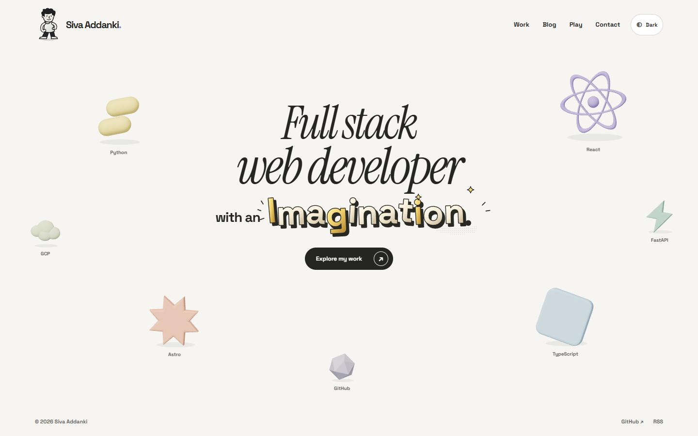
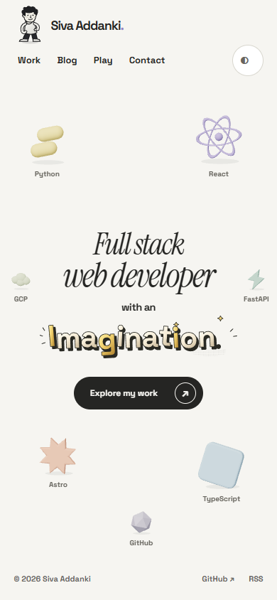
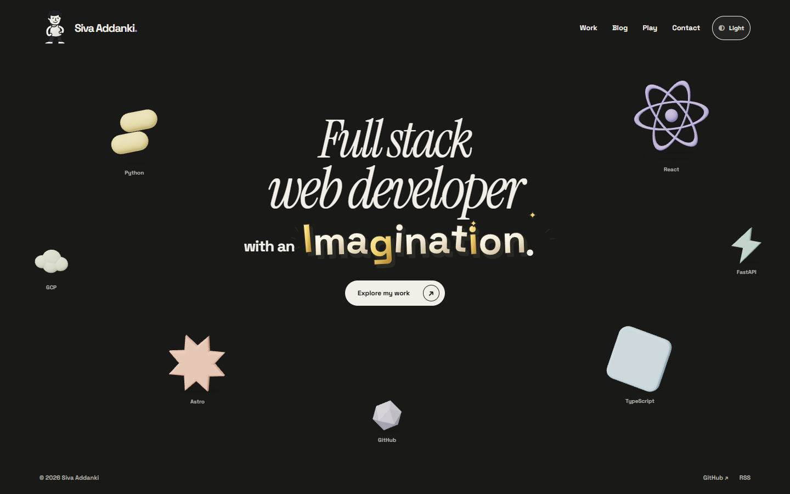
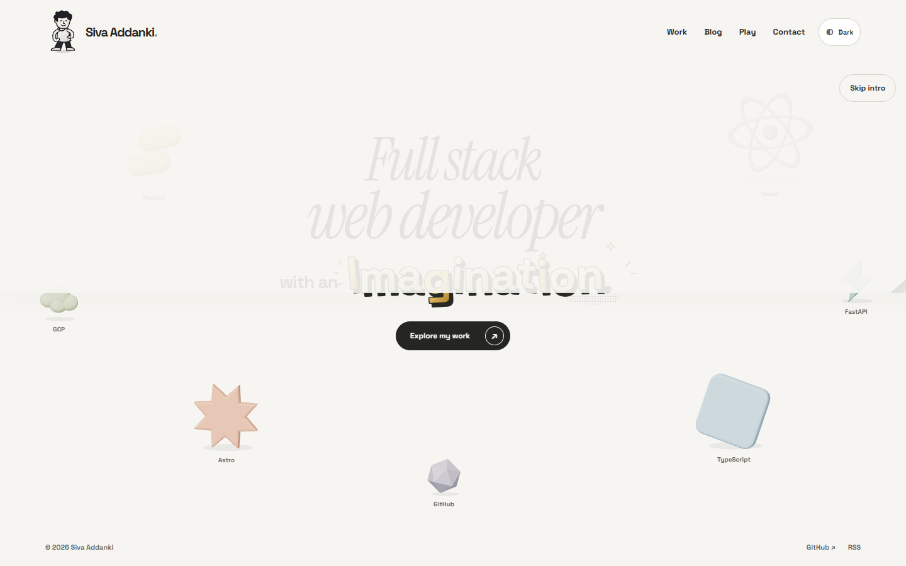

# P05 selected comic lettering and paper reveal

The operator selected the comic/cartoon direction. **Imagination is now static illustrated lettering on the homepage**, with cream/gold faces, chunky ink extrusion, uneven letter angles, stars and a small halftone accent. The earlier animated glyph treatment and Animate Imagination button are removed.

The complete word remains natural accessible heading text. Decorative vector artwork is embedded in the HTML, so it needs no JavaScript, font loading or separate image request. Light and dark versions use distinct gradient IDs. Paper reveal and the character's kick/punch interactions are unchanged.

## Current preview

[Play or download the refreshed 35-second walkthrough](https://raw.githubusercontent.com/avsssai/avsssai.github.io/poteto/portfolio-p05/docs/portfolio-review/p05/review.webm)

Recorded from application `3819fdf84606b9bbdc2a116dda42b2e955b1142f`. Compressed preview:960×600,1,117,563bytes,34.565seconds. Browser metadata and decoded frames inspected, not a continuous watch. It shows the selected static word, first-visit peel, inherited cartoon interaction, repeat loading, resized narrow viewport, reduced motion, keyboard skip under delayed scene loading and work navigation. Narrow segment is resized desktop, not touch hardware. Full recording stays outside the repository at `portfolio-evidence/P05/lettering/selected-recording/review.webm`.

### Desktop

### Phone

### Dark

### Retained paper reveal

### Skipped, reduced motion and no JavaScript

[Skipped intro](skip.png) · [Reduced motion](reduced.png) · [No JavaScript](no-js.png)

[Earlier three-direction comparison](lettering/README.md), retained as design history rather than alternative homepage defaults.

## Focused verification

Application `3819fdf` passed28puretests and build/type checks, with0errors/0warnings/3unchanged P04 hints. Touched supported files passed formatting; git diff --check passed.

Seven affected P05 browser cases passed without page errors: first-ready reveal, native keyboard skip/focus, static letters/light-dark/layout, touch at390/320px, reduced motion, no JS and lifecycle. Two additional peel/skip capture cases and the inherited P04 effects case passed. Static letters remain motionless under pointer/touch, have no demo control or heading tab stops, retain the complete accessible name and cause no horizontal scroll. Screenshots were inspected.

A first dark screenshot exposed a real inline-SVG gradient collision. Theme-specific ID namespaces fixed it; the final browser case asserts ID uniqueness and the corrected dark screenshot was inspected. The failed-looking initial capture is preserved in `selected-live`; final evidence is `selected-final`.

A **one-pair smoke probe**, not a five-run benchmark, ran at4×CPU/1440×900/Chrome156/local previews. It passed all six current gates: maxCLS0.02497,ready-to-dismiss1425.3ms,stalledcover4806.4ms,keyboard-generated skipack0.6ms,zero word animations/demo controls andzero DOM growth. Single observed fully uncovered heading cost was+2598.8ms versus original trunk7cf8da1. The first-visit entrance still carries visibility delay; native navigation is never disabled. No letter-frame-rate metric applies to a static word.

Receipts: `portfolio-evidence/P05/lettering/selected-{unit-final.log,build-final.log,final,preview,character,smoke-perf,recording}`. Earlier five-pair performance and independent PASS+NOTES at934a6b6 predate this selected static implementation. No new independent review or five-run benchmark is claimed.

## Remaining gates

The direction is selected; final integrated sizing/appearance review remains open. Actual touch hardware, non-Chromium, screen-reader and provisional character likeness remain open. Native hidden/bfcache certification has not been expanded. No game work, P06, merge or deployment. PR11 remains open for review.
