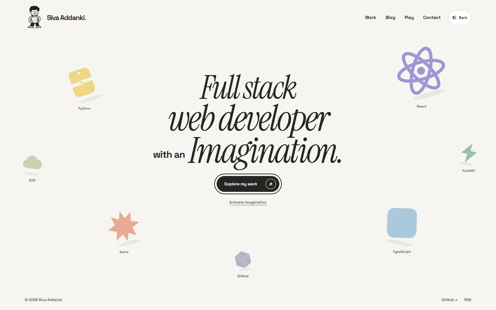
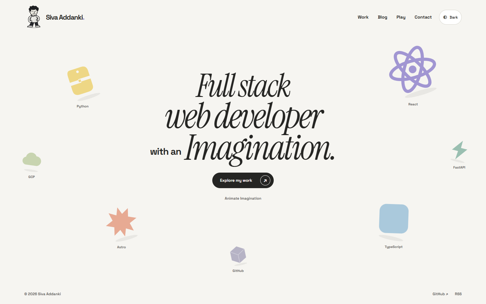
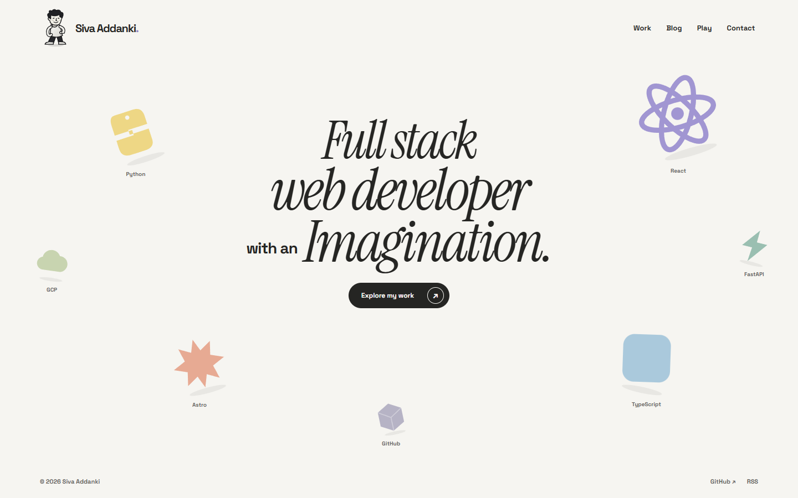

# P05 letters and paper reveal

P05 adds six deliberate accents to the natural word Imagination: stretch, ink offset, outline and a small colour burst. Explore the mapped letters with a fine pointer, or use the single **Animate Imagination** button with touch or keyboard. The source word stays readable and the heading layout does not move.

On a first visit, a hero-local paper cover waits for the scene's real first frame, then peels away over 1400 ms. **Skip intro** is available immediately. Errors, reduced motion, resize or hidden-page transitions dismiss it; a separate deadline removes it after at most 4800 ms of scheduled time. Repeat visits omit it. Storage failures never block the page. Header navigation remains outside the cover; the cover never disables native links.

## Preview

[Play or download the 34-second walkthrough](https://raw.githubusercontent.com/avsssai/avsssai.github.io/poteto/portfolio-p05/docs/portfolio-review/p05/review.webm)

The walkthrough includes first-visit reveal, letter demonstration, the inherited cartoon interaction, repeat loading, a narrow viewport, reduced motion, keyboard skip under a delayed scene and work navigation. The narrow segment is resized desktop, not touch hardware.

Recorded from reviewed `934a6b6b249862cfebd93e9ef74c4a4ff018ba55`, whose application is unchanged from `f8bc1027318a2bbdfb3d7210c748fabd91877a8d`. The compressed preview is 960×600, 1,082,819 bytes and 34.433 seconds. Browser metadata and decoded frames were inspected, not a continuous watch. The full recording remains outside the repository at `portfolio-evidence/P05/recording/review.webm`.

### Paper midway through its peel

### First visit complete

### Letter exploration

### Narrow viewport

### Skipped intro

### Reduced motion and no JavaScript

## Verification

Reviewed head `934a6b6`, based on P04's squash `e0e500a` on the P03 branch. Later gallery/recorder changes do not alter the application, tests or verification/performance drivers.

- 28 pure tests, build/type check and 12 compact browser cases passed without page errors. Type checks report 0 errors, 0 warnings and 3 unchanged P04 script hints. Existing deferred-chunk size notice remains. Keyboard skip was tightened and independently rechecked.
- Fresh isolated independent review returned **PASS+NOTES**, no blockers. It ran the 28 tests, type check and eight affected browser cases, inspected screenshots and audited performance receipts. Native subagents/model config were absent; fresh explicit same-model CLI sessions were used, not a cross-family panel. The reader's raw CRLF checkout failed its programmatic formatting comparison; every LF-normalized in-memory file passed. Owner touched-file formatting passed.
- Five interleaved cold loads per revision, Chrome156, 1440×900, 4× CPU and local previews. Baseline is original trunk `7cf8da1`, not the P04 parent or current deployed revision. Median fully uncovered heading: **370.8 ms baseline, 3037.3 ms P05**, an intentional first-visit visibility cost of **2666.5 ms**. Fully uncovered work-link cost is also2666.5 ms. Static HTML/native link availability is recorded separately; the cover is pointer-transparent and navigation is never disabled. These are local automation proxies, not field paint metrics.
- Max CLS **0.02469**, ready-to-dismiss **1410.9 ms**, stalled cover **4804.4 ms**, keyboard-generated skip acknowledgment **0.4 ms**, active letter rAF p95 **17 ms**, settled DOM growth **0**, retained letter animations **0**. All six final performance gates passed.
- The first performance receipt failed the DOM gate at160→167 nodes because it sampled before scene startup finished. The final driver waits for real scene readiness plus500ms before the active baseline, then records167→167. No application change was needed; the original failed receipt is preserved. Do not call the first run green.

Receipts remain outside the repository in `portfolio-evidence/P05/{verified-live,keyboard-final,verified-perf,final-perf,review,recording}` plus build/unit logs. The initial accessible-name failure was fixed with an explicit space between “with an” and the word component, then affected checks and the full compact pass reran.

## Open review gates

Final peel/letter appearance and timing need operator approval. Actual-device, non-Chromium, screen-reader and likeness review remain open. Synthetic Astro lifecycle events and normal back navigation were checked; this is not exhaustive real-router or native bfcache certification. P04 remains inherited, not a newly rerun broad interaction audit. No game work, invented portfolio content, merge or deployment. P06 has not started.
