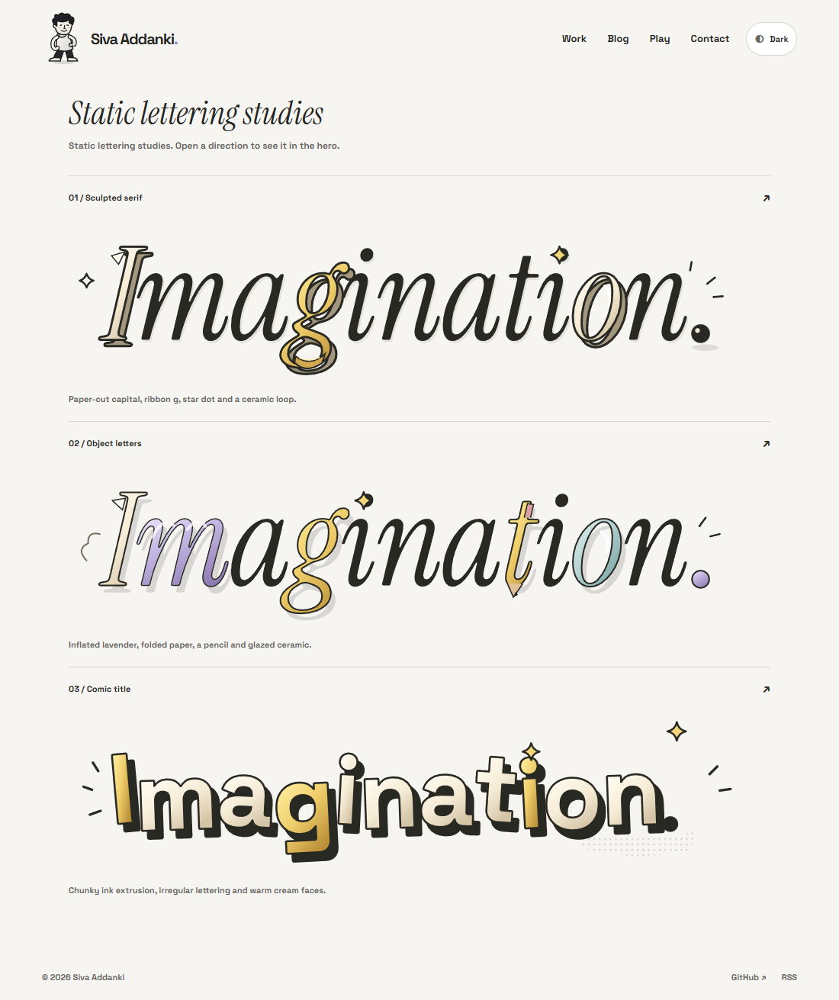
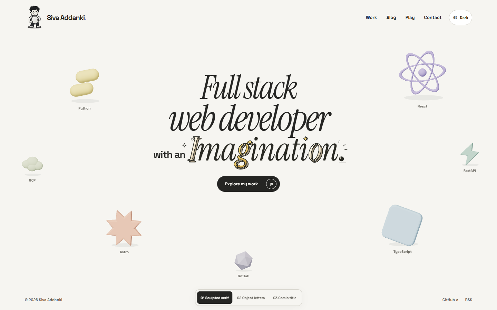
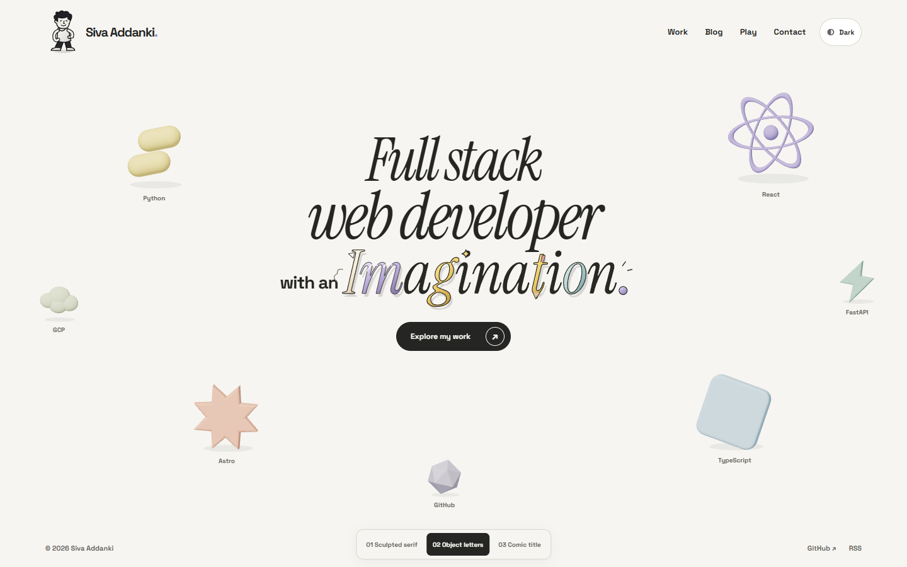
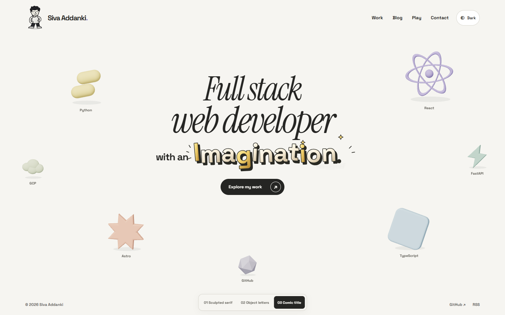

# Static Imagination lettering studies

Three static directions, shown in the existing hero. No hover effect, word animation or demo button on these review pages. The scene, character and paper reveal are unchanged. The operator selected03, the comic title; it is now the homepage default. These captures remain the earlier comparison studies. [See the current homepage gallery](../README.md).

## Compare the lettering

## 01 / Sculpted serif

Closest to the existing headline. A paper-cut capital, gold ribbon g, star dot, shaded o and spherical period keep most of the word quiet.

[Phone view](sculpted-mobile.png) · [Dark phone view](sculpted-dark.png)

## 02 / Object letters

More colour and material contrast: lavender m, folded-paper I, gold g, pencil t and glazed blue o. The other letters stay ink-black.

[Phone view](objects-mobile.png) · [Dark phone view](objects-dark.png)

## 03 / Comic title

The boldest change. Chunky extrusion, warm cream faces, irregular letter angles, a star and small halftone detail. More cartoon-title than editorial serif.

[Phone view](comic-mobile.png) · [Dark phone view](comic-dark.png)

## Live local studies

These are loopback-only, not public website deployments:

- Comparison board: http://127.0.0.1:4331/lab/lettering/
- Sculpted serif: http://127.0.0.1:4331/lab/lettering/sculpted/
- Object letters: http://127.0.0.1:4331/lab/lettering/objects/
- Comic title: http://127.0.0.1:4331/lab/lettering/comic/

## Checks and scope

Build/type check and 28 pure tests passed. Three real-surface study checks cover desktop1440px, phone390/320px, no horizontal scroll, complete natural heading name, no word animations/demo control, light/dark artwork and native work navigation. No-JavaScript heading/navigation also passed for all three. Screenshots were inspected. Four affected homepage regression cases passed: ready reveal, letters, no JS and lifecycle. `scripts/verify-lettering.cjs` reproduces the study captures/checks.

These are visual studies, not a newly independently reviewed P05 application or performance benchmark. Earlier P05 performance/review receipts predate the added study routes. No new performance run or video was needed for static comparison assets. Original P05 video/gallery still show the earlier interactive lettering and must not be presented as these studies.

Outlines derive from the existing OFL Instrument Serif and Space Grotesk assets, with locally drawn folds, stars, pencil details and shading. Provenance and regeneration are recorded in `docs/portfolio-assets.md` and `scripts/generate-lettering-studies.py`. No new dependency, invented portfolio copy, game work, merge or deployment.

Direction03 has replaced the rejected interactive lettering on the same unmerged P05 PR11. The comparison routes remain for reference. Actual-device, non-Chromium and final visual approval remain open.
