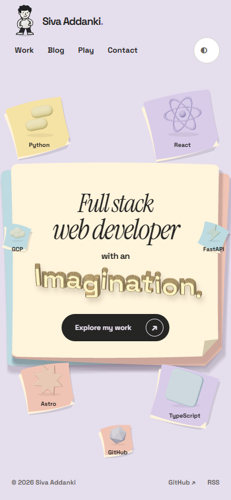
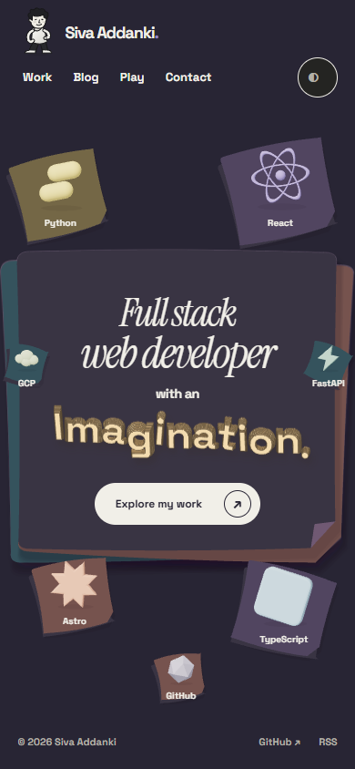

# C — layered paper-cut stage

The operator rejected the previous topographic-map surface and selected **C: a paper-cut stage**. This is the new local prototype for visual review, not the earlier contour-map treatment.

## ▶ Watch the new phone video

**[Play the 17-second MP4 — 289 KB](https://raw.githubusercontent.com/avsssai/avsssai.github.io/poteto/portfolio-terrain-preview/docs/portfolio-review/paper-cut/phone.mp4)**

Light paper stage → React walking journey and different return → dark stage → TypeScript journey and return. Real-time capture, no audio.

## What changed

- A cream central sheet over offset blue and peach sheets, on a pale lilac desk.
- Uneven curved cut edges, paper thickness, contact shadows and a lifted triangular corner.
- Separate pastel paper platforms underneath the technologies.
- Dark material palette; technology labels use full-contrast ink rather than muted text.
- The topographic-map background and contour shader are removed. Existing sculpted lettering, dotted walking trips, impact payoff and cream peel are retained.

### Desktop

### Dark

## Evidence and scope

- Captured from the current local P05 working tree above checkpoint `a2aa474`, at http://127.0.0.1:4331/. The prototype implementation is still uncommitted; this branch publishes **gallery files only**, not application source, a merged PR or a deployment.
- H.264 MP4: **295,905 bytes**, **17.076867 seconds**, **390×844**. Desktop Chrome portrait viewport, **not physical touch hardware**. Repeat-visit state intentionally skips the existing cream peel to show the selected surface immediately.
- Recording driver observed complete outbound/return/home trips with no page errors. Browser playback metadata and decoded frames at3/5/10/13/16seconds inspected; not a claim of watching the whole video continuously. [Capture events](recording.json) · [Encoded playback metadata](decoded.json).
- Owner verification: **50 pure tests**, build/typecheck with zero errors/warnings and three inherited hints, **nine focused browser cases passed**. Includes all seven targets at1440/390/320, dark mode, native heading, cancellation/preferences, no-JS fallback, title context loss and retained peel/Skip. Existing navigation and character controller remain functional.
- One fresh read-only source/screenshot reader flagged label contrast and shadow-mesh overhead. Labels now use full ink, including dark butter-paper contrast approximately4.84:1; surface shadow meshes were reduced from51to16. Owner reran all checks and recorded this video after those fixes. The reader did not independently run tests.
- Two-trip4xCPU smoke: active-rAFp95 16.9/16.8ms, DOM282→282, zero retained WAAPI animations and no new scene/title frames over1s idle. First-trip planning135.6ms and subsequent75ms under throttling remain tuning items; not GPU/field FPS or production-readiness certification.
- Final surface appearance/feel approval, physical-device, non-Chromium and screen-reader checks remain open. No automatic merge, deployment or P06.

[Previous rejected map-surface preview, retained only for comparison](../terrain/README.md).
