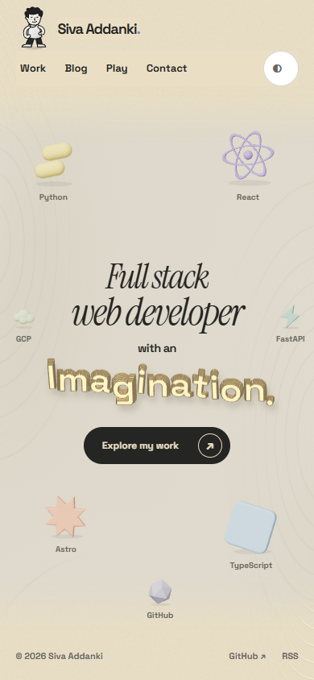
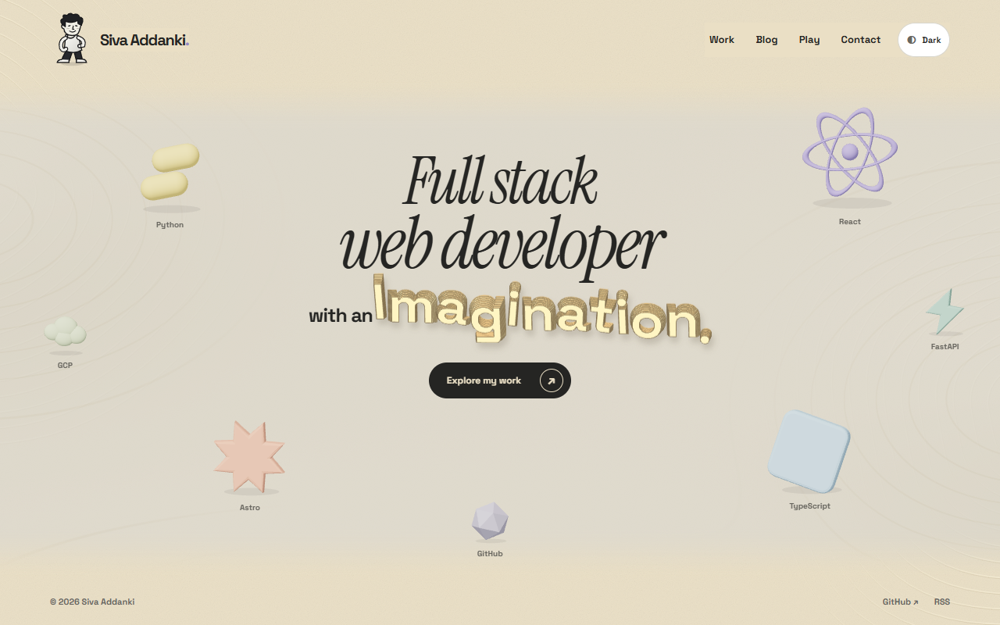
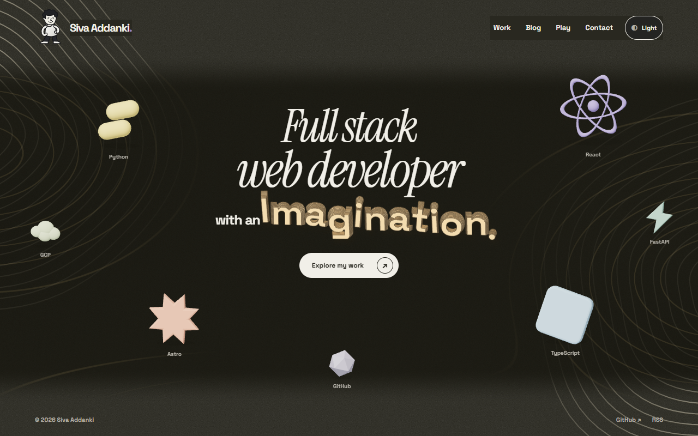

# Paper-world homepage — video preview

Current **local prototype**, recorded after the request for a page surface that feels unlike plain white. Warm textured paper, shallow topographic relief, raised contour lettering, and a walking character leaving a dotted trail and taking a different route home.

## Watch on your phone

### Portrait walkthrough — 17 seconds · 285 KB

**[▶ Play the phone video (MP4)](https://raw.githubusercontent.com/avsssai/avsssai.github.io/poteto/portfolio-terrain-preview/docs/portfolio-review/terrain/phone.mp4)**

Light paper surface → React walking trip and separate return → dark surface → TypeScript trip and return. Recorded at a 390×844 desktop Chrome viewport, **not physical touch hardware**.

### Desktop walkthrough — 27 seconds · 1.6 MB

**[▶ Play the desktop video (MP4)](https://raw.githubusercontent.com/avsssai/avsssai.github.io/poteto/portfolio-terrain-preview/docs/portfolio-review/terrain/desktop.mp4)**

Light paper surface → React trip and separate return → GitHub journey → dark surface → FastAPI journey. Recorded at 1280×800, encoded at 960×600.

Both are real-time screen recordings of the live local homepage, no audio. H.264 MP4s for convenient phone playback; click the bold video link or thumbnail. They show the current material treatment, not the older flat-panel reveal or older comic lettering studies.

## Dark material

[Dark portrait screenshot](phone-dark.png)

## Provenance and scope

- Source: local, uncommitted P05 terrain/walking/surface work above cream-peel checkpoint **`a2aa474`**. Recorded from **http://127.0.0.1:4331/**. Repeat-visit state intentionally omits the cream peel so the requested surface and routes are immediately visible.
- This is a **gallery-only branch**. It does not publish the prototype application source, merge any PR or deploy the site. Application source remains in the local P05 worktree.
- Desktop MP4: **1,672,099 bytes**, **26.711633 seconds**, **960×600**. Portrait MP4: **291,595 bytes**, **17.024267 seconds**, **390×844**. Original WebM recordings retained outside the repository. Playback metadata and decoded frames inspected; not a claim of continuously viewing both videos.
- Recording driver observed complete outbound/return/home phases and no page errors. Capture events: [recording.json](recording.json). Encoded playback metadata: [decoded.json](decoded.json).
- Prior focused owner verification: 44 pure tests, build/typecheck with zero errors/warnings and three inherited hints, nine browser cases including all seven targets at1440/390/320, cancellation, dark mode, fallback and existing peel/Skip. Those checks are of the local implementation, not the historical application source in this gallery branch.
- Operator visual approval, physical devices, non-Chromium and screen-reader verification remain open. Static relief draw-call/startup cost and first-trip CPU planning are still tuning items. No production-readiness claim.
